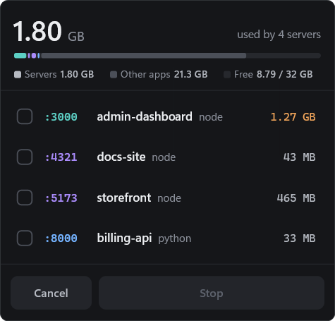
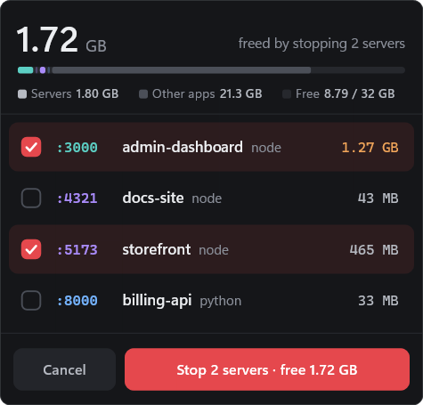

<div align="center">


# PortSide

**Your forgotten dev servers, one click away from gone.**

A tiny Windows tray app that finds the local HTTP servers you left running,
shows how much memory each one holds, and stops them in one click.

[](https://github.com/Gyom03/PortSide/releases/latest)
[](https://github.com/Gyom03/PortSide/actions/workflows/ci.yml)


<br>


&nbsp;&nbsp;


</div>

<br>

## Why

A `vite` from this morning, a `next dev` from yesterday, a Python API you forgot about, all still running and holding gigabytes of RAM. Finding them means digging through Task Manager for a dozen anonymous `node.exe` processes and guessing which one is which.

PortSide shows them by **project name** and **port**, with their **real memory footprint**, so you can stop the ones you don't need.

## Features

- **Finds real web servers.** It lists processes that actually answer HTTP or HTTPS on a local port, and confirms each one with a tiny probe.
- **Human names.** Each server is labeled with its project folder and tool (`storefront · vite`, `billing-api · python`), not a PID.
- **True memory cost.** Memory is summed over the whole process tree, so watchers, workers and child servers are counted together under one entry.
- **Memory bar.** At a glance you see each server's share next to other apps and free memory.
- **Stop cleanly.** PortSide terminates the server along with all its child processes. It checks process identity first, so a recycled PID is never hit.
- **Open in browser.** Click a port to open `http(s)://localhost:<port>`.
- **Stays out of the way.** The app sits in the tray and uses almost no resources while idle (see [Lightweight by design](#lightweight-by-design)).
- **Native look.** Dark theme, Windows 11 rounded corners, per-monitor DPI, and crisp text at any scale.

## Safe by default

PortSide only lists processes that look like **your dev servers**, and never offers anything else for termination:

| Shown | Never shown |
|---|---|
| Console runtimes in your session: `node`, `python`, `dotnet`, `go`, `java`, `deno`, `bun`… | System services (`svchost`, `lsass`, `services`…) |
| Servers spawned by `npm`, `pnpm`, `cargo`, `uvicorn`, `rails`… | Docker and WSL plumbing |
| | GUI apps with a local server (Spotify, Discord, VS Code helpers…) |
| | Installed launchers and updaters (`Program Files (x86)`, `ProgramData`, Store apps) |
| | Other users' processes |

If a server runs elevated, PortSide reports it as **access denied** instead of failing silently.

## Install

1. Download `portside-<version>-windows-x64.exe` (or `arm64`) from the **[latest release](https://github.com/Gyom03/PortSide/releases/latest)**.
2. Put it wherever you like and run it. There's no installer and no runtime to install.
3. Right-click the tray icon and select **Start with Windows** to have PortSide start at login.

> [!NOTE]
> The executable is not code-signed yet. On first launch, Windows SmartScreen may show a warning. Click **More info → Run anyway**.

## Usage

Click the tray icon to open the panel. Click it again, or click anywhere else, to close it.

| Action | How |
|---|---|
| Select a server | Click its row |
| Open it in the browser | Click its `:port` |
| Stop the selection | **Stop** button or <kbd>Enter</kbd> |
| Select / deselect all | <kbd>Ctrl</kbd> + <kbd>A</kbd> |
| Close the panel | <kbd>Esc</kbd> |
| Start with Windows, Quit | Right-click the tray icon |

Running `portside.exe` again while it's already running simply opens the panel. Pass `--background` to start it silently in the tray.

## How it works

```
TCP listeners ─▶ filter ─▶ probe ─▶ group ─▶ name
 (IP Helper)     own session,  HEAD /   child servers    node_modules path
                 console exe,  or TLS   folded into      or working dir
                 not a system  Client-  their parent     → "storefront · vite"
                 / GUI app     Hello
```

1. **Listeners**: it reads every listening TCP socket and its owning PID through the IP Helper API.
2. **Filtering**: it keeps only console-subsystem executables (read from the PE header) from the current session, outside system and installed-app folders.
3. **Probing**: it sends an `HTTP/1.1` request without `Host`, so most servers reply `400` immediately without compiling or routing anything. If that fails, it tries a minimal TLS ClientHello. Ports that answer neither are skipped.
4. **Grouping**: a server started by another listed server is merged into its ancestor.
5. **Naming**: the project name comes from the `node_modules` path in the command line, or from the process's working directory.

### Lightweight by design

- A single native executable of about 400 KB, written in Rust on top of Win32 and Direct2D, with no framework and no web view.
- It scans every 30 s while hidden and every 1.5 s while the panel is open.
- When the panel is hidden, PortSide hands its memory pages back to Windows.
- The app icon is drawn procedurally at build time, so the repo contains no binary assets.

## Build from source

You need [Rust](https://rustup.rs) (stable, edition 2024) and the MSVC build tools.

```powershell
git clone https://github.com/Gyom03/PortSide.git
cd PortSide
cargo build --release
.\target\release\portside.exe
```

## Releasing

Releases are fully automated with GitHub Actions. To publish one, push a version tag:

```powershell
git tag v0.2.0
git push origin v0.2.0
```

The [release workflow](.github/workflows/release.yml) builds x64 and ARM64 binaries and stamps the tag's version into the executable. It then publishes a GitHub Release with the `.exe` files, `.zip` archives, SHA-256 checksums and auto-generated release notes. Tags containing a hyphen (such as `v1.0.0-beta.1`) are published as pre-releases.

<br>

<div align="center">
<sub>Made for developers who have too many terminals open.</sub>
</div>
